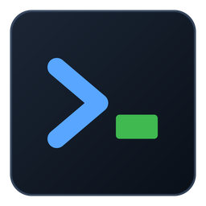
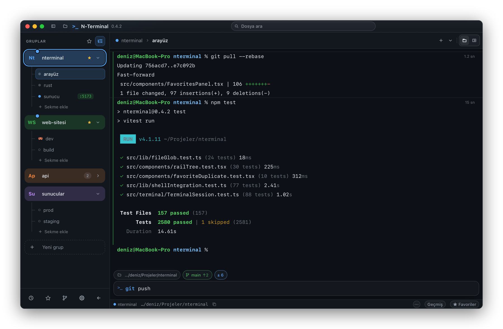
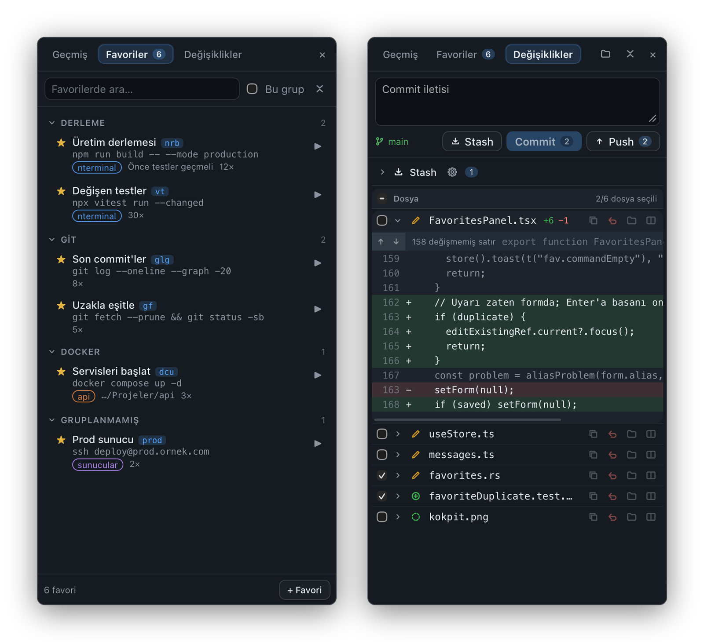
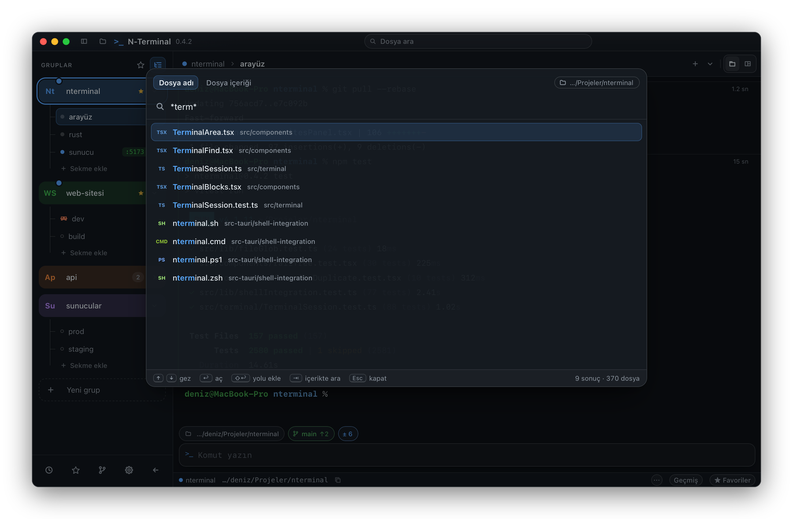
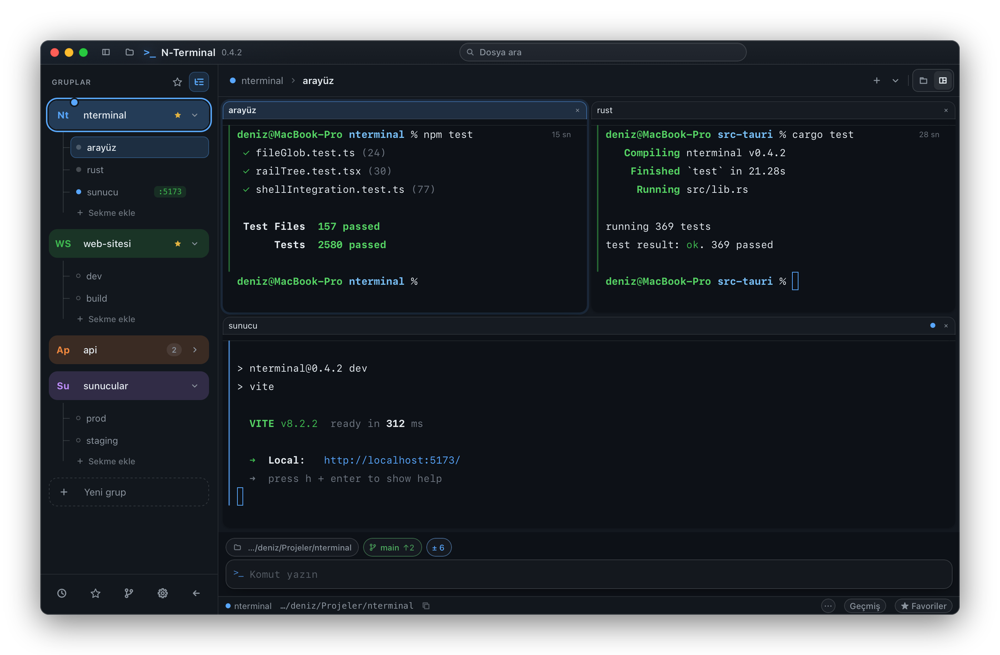
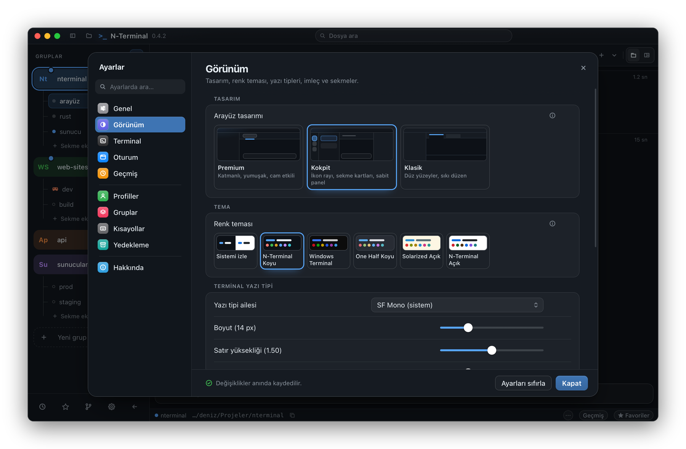
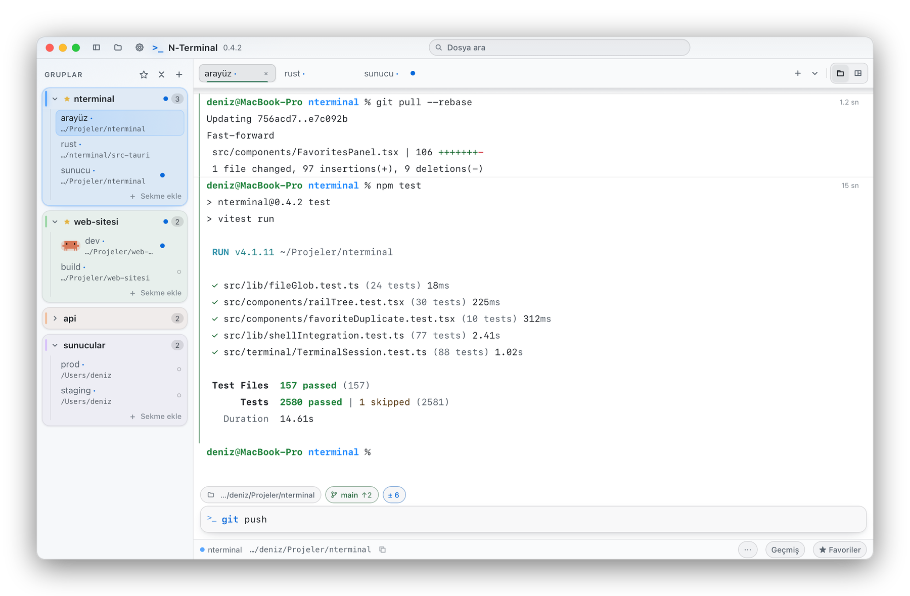

<div align="center">



# N-Terminal

**Projelerinizi gruplara ayıran, komutlarınızı hatırlayan terminal.**

macOS ve Windows için · Türkçe ve İngilizce arayüz · Ücretsiz ve açık kaynak

[](https://github.com/NYAYAN/NTerminal/releases/latest)
[](https://github.com/NYAYAN/NTerminal/actions/workflows/build.yml)
[](LICENSE)

**[İndir](https://github.com/NYAYAN/NTerminal/releases/latest)** &nbsp;·&nbsp;
[Kurulum](#paketi-indirip-kurmak) &nbsp;·&nbsp;
[Öne çıkanlar](#öne-çıkanlar) &nbsp;·&nbsp;
[Kısayollar](#klavye-kısayolları) &nbsp;·&nbsp;
[Belgeler](#belgeler)



</div>

## Öne çıkanlar

### Her proje bir grup

Her grubun kendi rengi, sekmeleri ve başlangıç klasörü var. Kokpit tasarımında
soldaki grup bölmesini genişletince sekmeler grubun altında ağaç gibi listelenir.
Sekmeleri sürükleyerek gruplar arasında taşıyabilir, yıldızla işaretlediğiniz
favori grupları tek tıkla süzebilirsiniz. Uygulamayı kapatıp açtığınızda gruplar, sekmeler, çalışma
klasörleri ve ekran çıktısı kaldığı yerden gelir.

### Her komut kendi bloğunda

Her komut ayrı bir bloğa yazılır. Kenardaki çizgi komutun başarılı olup
olmadığını, sağ üst köşe ne kadar sürdüğünü gösterir. Komut kutusu altta sabit
durur; yazarken geçmişten öneri gelir. macOS'ta varsayılan istem renklenir, böylece
uzun bir çıktının içinde nerede komut yazdığınız hemen görünür. Bir sekmede
geliştirme sunucusu çalışıyorsa portu (`:5173`) sekmenin yanında, Claude Code
çalışıyorsa onun simgesi görünür.

### Favoriler ve Git, yan panelde

**Favori komutlar.** Sık kullandığınız komutları klasörlere ayırın; her birine
kısa ad, not, grup ve kısaltma verin. Komut kutusuna kısaltmayı (`nrb`) yazıp
Enter'a basınca komutun tamamı çalışır; ne çalışacağı kutunun içinde önceden
yazar.

**Değişiklikler.** Dosyaları seçip commit'leyin, push'layın, stash'e alın. Farkı
panelin içinde ya da ayrı bir pencerede yan yana görün, dal seçiciyle dal
değiştirin. Komut kutusunun üstünde dal adı, gönderilmemiş commit sayısı ve
değişen dosya sayısı her zaman görünür.

<p align="center">
  
</p>

### Dosyayı bulmak: Ctrl+P

Bulunduğunuz klasörde dosyayı adıyla ya da `*.tsx`, `src/**/*.test.ts`,
`*.{ts,tsx}` gibi kalıplarla bulun; her dosya türü kendi etiketiyle görünür. Aynı
pencerenin **Dosya içeriği** sekmesi dosyaların içinde arar. Dosya paneli ise
klasör ağacını, dosya görüntüleyiciyi ve küçük düzenlemeleri tek yerde toplar.

<p align="center">
  
</p>

### Sekme ya da bölme

Grubun sekmelerini tek tek ya da yan yana bölmeler hâlinde görün; ikisi arasında
tek tuşla geçin (macOS'ta ⌘⇧E, Windows'ta Ctrl+Shift+E).

<p align="center">
  
</p>

### Size göre

Üç tasarım (Kokpit, Premium, Klasik), açık ve koyu renk temaları; yazı tipi, satır
aralığı, istem renkleri, kabuk profilleri ve kısayollar. Değişiklikler anında
uygulanır. Bütün yapılandırmanızı tek dosyayla başka bir bilgisayara
taşıyabilirsiniz (*Ayarlar › Yedekleme*).

<p align="center">
  
  
</p>

### Ve dahası

- **Komut geçmişi:** her komut klasörü, süresi ve sonucuyla kaydedilir. Geçmişte
  hızlı arama macOS'ta ⌘R, Windows'ta Ctrl+R; boş satırda ↑ geçmiş panelini açar.
- **Kabuklar (shell):** zsh, bash, PowerShell 7, Windows PowerShell, Git Bash ve
  WSL tam destekli; cmd.exe ve fish da çalışır. Makinedeki kabukları uygulama
  kendisi bulur.
- **Güvenli kapatma:** sekme kapatılırken onay sorulur (ayardan değiştirilebilir);
  kilitlenen sekme hiçbir yoldan kapanmaz; silme işlemleri her zaman onay ister.
- **Kendiliğinden güncelleme:** yeni sürüm uygulamanın içinden gelir; paket
  imzası doğrulanarak kurulur, sekmeler yeniden açılışta geri gelir.
- **Arka planda çalışma:** pencereyi kapatınca uygulama macOS'ta menü çubuğunda,
  Windows'ta bildirim alanında çalışmaya devam eder.

## Paketi indirip kurmak

Son sürüm: **[Releases › Latest](https://github.com/NYAYAN/NTerminal/releases/latest)**.
Bir kez kurduktan sonra yeni sürümler **uygulamanın içinden** gelir
(*Ayarlar › Hakkında › Güncelle ve yeniden başlat*); aşağıdaki adımlar yalnızca
ilk kurulum için.

**macOS 11+ (Apple Silicon):** `N-Terminal_<sürüm>_aarch64.dmg` dosyasını açıp
N-Terminal'i **Uygulamalar** klasörüne sürükleyin. İlk açılışta macOS "Apple,
N-Terminal'in kötü amaçlı yazılım içermediğini doğrulayamadı" der
(*“N-Terminal” Not Opened*). **Bitti**'ye (*Done*) basın, sonra:

1. **Sistem Ayarları › Gizlilik ve Güvenlik**'i açın (*System Settings ›
   Privacy & Security*).
2. En alttaki **Güvenlik** bölümünde "N-Terminal engellendi" satırının
   yanındaki **Yine de Aç**'a (*Open Anyway*) basın.
3. Mac'inizin parolasıyla ya da Touch ID ile onaylayın. Bu onay yönetici
   yetkisi ister; standart bir kullanıcı hesabındaysanız macOS bir yöneticinin
   adını ve parolasını sorar.

Bu adım bir kez yapılır; uygulamanın kendi kurduğu güncellemelerde tekrar
etmez. macOS uygulamayı açmıyor, "hasarlı" diyor ya da **Yine de Aç** düğmesi
çıkmıyorsa: [macOS: ilk açılış](#macos-ilk-açılış).

**Windows 10/11:** `N-Terminal_<sürüm>_x64-setup.exe` dosyasını indirip
çalıştırın. Kurulum yönetici izni istemez, uygulama kullanıcı klasörüne kurulur
(kurumsal dağıtım için aynı sürümün `.msi` paketi de var). Paket imzasız olduğu
için Windows "Windows bilgisayarınızı korudu" (*Windows protected your PC*)
diyebilir: **Ek bilgi** (*More info*) › **Yine de çalıştır** (*Run anyway*).
Daha önce `.msi` ile kurduysanız `setup.exe` onu kaldırıp uygulamayı kullanıcı
klasörüne taşır; görev çubuğuna sabitlenmiş düğmeyi bir kez kaldırıp yeniden
sabitleyin ([KURULUM.md](KURULUM.md)).

## macOS: ilk açılış

N-Terminal Apple'ın ücretli geliştirici sertifikasıyla değil, kendi imzasıyla
(ad-hoc) dağıtılıyor. macOS internetten indirilen ve Apple'ın onaylamadığı bir
uygulamayı ilk açılışta durdurur; yukarıdaki **Yine de Aç** adımı bu yüzden
gerekli. Uygulamanın içinden gelen güncellemeler internetten indirilmiş
sayılmadığı için bu adım tekrar etmez.

**"Hasarlı" uyarısı ya da Yine de Aç düğmesi yoksa.** Bazı durumlarda (örneğin
eski sürümlerin paketlerinde) macOS uygulamanın hasarlı olduğunu söyleyip Çöp
Sepeti'ne taşımayı önerir ve Sistem Ayarları'nda **Yine de Aç** düğmesi hiç
çıkmaz. Paket bozuk değildir; macOS'un indirilen dosyaya koyduğu karantina
işaretini kaldırmak yeterli. **Terminal**
uygulamasını açın (Uygulamalar › İzlenceler › Terminal) ve şunu yazın:

```bash
sudo xattr -dr com.apple.quarantine /Applications/N-Terminal.app
```

- `sudo` komutu yönetici yetkisiyle çalıştırır ve **Mac'inizin giriş
  parolasını** sorar. Parolayı yazarken ekranda hiçbir şey görünmez; bu
  normaldir, yazıp Enter'a basın.
- Hesabınız yönetici değilse `sudo` çalışmaz. Komutu yönetici hesabıyla
  çalıştırın ya da bilgisayarın yöneticisinden yardım isteyin.
- Uygulamayı Uygulamalar klasörü dışında bir yere koyduysanız komuttaki yolu ona
  göre değiştirin. N-Terminal'i Finder'dan Terminal penceresine sürüklemek yolu
  kendisi yazar.

Komut bir kez çalıştırılır; sonrasında uygulama normal açılır.

**İzin istekleri.** Terminalde çalıştırdığınız bir komut ilk kez Masaüstü,
Belgeler ya da İndirilenler klasörüne eriştiğinde macOS, N-Terminal'in o klasöre
erişmesine izin verip vermediğinizi sorar; **İzin Ver**'e basın. Bütün diskte sorunsuz çalışmak için
N-Terminal'i *Sistem Ayarları › Gizlilik ve Güvenlik › Tam Disk Erişimi*
listesine ekleyebilirsiniz. Uygulama Apple sertifikasıyla imzalı olmadığı için
macOS bu izinleri yeni sürüme geçişte yeniden sorabilir.

Teknik ayrıntılar (imzanın türü, ölçümler, Developer ID ile tamamen uyarısız
dağıtım): [docs/gelistirme.md](docs/gelistirme.md#macos-paketinin-imzası-ve-ilk-açılış).

## Klavye kısayolları

| Ne yapar | macOS | Windows |
|---|---|---|
| Yeni sekme / Sekmeyi kapat | ⌘T / ⌘W | Ctrl+T / Ctrl+W |
| Sonraki / Önceki sekme | ⌃Tab / ⌃⇧Tab | Ctrl+Tab / Ctrl+Shift+Tab |
| Yeni grup | ⌘⇧N | Ctrl+Shift+N |
| Dosya ara | ⌘P | Ctrl+P |
| Dosyaların içinde ara | ⌘⇧F | Ctrl+Shift+G |
| Komut paleti | ⌘⇧P | Ctrl+Shift+P |
| Geçmişte hızlı arama | ⌘R | Ctrl+R |
| Favori komutlar | ⌘⇧B | Ctrl+Shift+B |
| Sekme / bölme görünümü | ⌘⇧E | Ctrl+Shift+E |
| Terminalde ara | ⌘F | Ctrl+Shift+F |
| Terminali temizle | ⌘K | Ctrl+Shift+K |
| Ayarlar | ⌘, | Ctrl+, |

Hepsi *Ayarlar › Kısayollar*'dan değiştirilebilir. Tam liste ve fare
davranışları: [docs/ozellikler.md](docs/ozellikler.md#klavye-kısayolları).

## Verileriniz

Ayarlar, gruplar, komut geçmişi, favoriler ve kaydedilen ekran çıktıları sizin
bilgisayarınızda, tek bir klasörde durur; hiçbir yere gönderilmez. Uygulama
yalnızca yeni sürüm olup olmadığını GitHub'dan sorar (*Ayarlar › Hakkında*'dan
kapatılabilir).

| Sistem | Klasör |
|---|---|
| macOS | `~/Library/Application Support/NTerminal` |
| Windows | `%APPDATA%\NTerminal` |

Programın yanına `nterminal-data` adlı bir klasör açarsanız uygulama taşınabilir
kipte çalışır ve her şeyi oraya yazar. Dosyaların ayrıntısı ve ayarları başka
makineye taşımak: [docs/ozellikler.md](docs/ozellikler.md#veri-dosyaları).

## Belgeler

| Belge | İçinde ne var |
|---|---|
| [Özellikler ve kullanım](docs/ozellikler.md) | Her özelliğin ayrıntısı: gruplar, geçmiş, favoriler, Git, dosya paneli, kabuk entegrasyonu, ayarlar |
| [Kaynaktan derleme](KURULUM.md) | Hangi klasörde hangi komut, hangi dosya oluşuyor |
| [Geliştirme](docs/gelistirme.md) | Mimari, testler, CI, paket imzası ve güncelleme anahtarı |
| [Geliştirme notları](NOTLAR.md) | Kararların arkasındaki ölçülmüş hatalar ve açık işler |

N-Terminal [Tauri 2](https://tauri.app) (Rust), React ve
[xterm.js](https://xtermjs.org) ile yazıldı. Terminal katmanı `portable-pty`
üzerinden Windows'ta ConPTY, macOS'ta yerel Unix PTY kullanır.

## Lisans

[MIT](LICENSE) © 2026 Nurullah YAYAN
